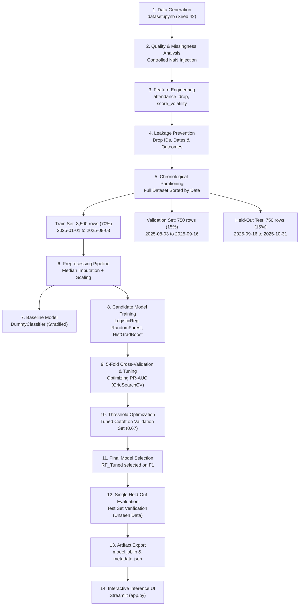

# Student Performance & At-Risk Prediction

> **An ML-powered academic decision-support application for identifying students who may benefit from additional academic support.**

[](https://student-performance-at-risk-prediction.streamlit.app/)
[](https://github.com/sekar-kumaran/Student-Performance-At-Risk-Prediction)

- **Live Deployed Application:** [student-performance-at-risk-prediction.streamlit.app](https://student-performance-at-risk-prediction.streamlit.app/)
- **Developer:** [Sekar Kumaran](https://github.com/sekar-kumaran)
- **Domain:** School Management / Academic Performance Analytics
- **Project Category:** Supervised Binary Classification / Predictive Analytics
- **Primary Interface:** Streamlit Multi-Page Web Application
- **Container Environment:** Docker (`Dockerfile` included in repository)

This project implements an end-to-end, reproducible machine learning pipeline and interactive decision-support interface. By monitoring observable pre-assessment behavioral signals—such as historical attendance decline, assignment submission punctuality, and prior assessment trajectories—the system flags students at risk of scoring below 40 on upcoming examinations 30 days in advance. 

*Disclaimer: This software is a decision-support prototype designed to assist academic mentors and counselors in prioritizing supportive outreach, and is explicitly not an automated grading, punitive, or tracking platform.*

---

## Table of Contents

1. [Project Background & Objectives](#project-background--objectives)
2. [Problem Statement](#problem-statement)
3. [Prediction Objective & Target Definition](#prediction-objective--target-definition)
4. [Key Technical Decisions & Engineering Rationale](#key-technical-decisions--engineering-rationale)
5. [Dataset Documentation](#dataset-documentation)
6. [Machine Learning Workflow](#machine-learning-workflow)
7. [Model Performance & Evaluation](#model-performance--evaluation)
8. [Application Features (Streamlit)](#application-features-streamlit)
9. [Architecture & Project Structure](#architecture--project-structure)
10. [Docker Setup & Container Execution](#docker-setup--container-execution)
11. [Local Development Setup](#local-development-setup)
12. [Reproducibility & Verification Testing](#reproducibility--verification-testing)
13. [Responsible AI & Ethical Limitations](#responsible-ai--ethical-limitations)
14. [Project Attribution & AI Assistance Disclosure](#project-attribution--ai-assistance-disclosure)

---

## Project Background & Objectives

The primary objective of this project is to develop a complete, mathematically sound, and leak-free machine learning decision-support solution within a school management context:
- Controlled data synthesis and exploratory data analysis (EDA).
- Principled feature engineering and strict temporal leakage prevention.
- Chronological train/validation/test partitioning.
- Pipeline-encapsulated data preprocessing and missing value imputation.
- Comparative evaluation across multiple candidate models against an empirical baseline.
- Hyperparameter tuning and decision threshold optimization for imbalanced classification.
- Model interpretability and error analysis.
- Production-style serialization and interactive UI delivery.

---

## Problem Statement

Academic institutions often struggle with delayed intervention: academic difficulty is typically diagnosed only after an end-of-term assessment is failed. By that time, student demoralization is high, and the window for remedial instruction has closed.

This project addresses this operational gap by answering a focused question:
> **Given a student's observable attendance patterns, assignment habits, and historical test scores up to the current date, will they score below 40 on their next assessment scheduled 30 days from now?**

### Operational Value
1. **Early Identification:** Alerts counselors 30 days prior to examination dates, creating actionable lead time for targeted tutoring and office hours.
2. **Resource Triage:** Helps academic departments efficiently allocate finite remedial support to students showing compounding risk indicators.
3. **Behavioral Diagnostic:** Disentangles whether risk stems primarily from attendance collapse, missing coursework, or test anxiety/comprehension gaps.
4. **Advisory Decision Support:** Model outputs serve strictly as an advisory check for human educators, never as autonomous decisions.

---

## Prediction Objective & Target Definition

The operational specification for the predictive task is formalized below:

| Specification Item | Definition & Setting |
|---|---|
| **Prediction Unit** | One student prediction snapshot at an observation point |
| **Prediction Target** | Next assessment score falling below 40 (`next_assessment_score < 40`) |
| **Positive Class (1)** | At-Risk (`at_risk_next_assessment = 1`) |
| **Negative Class (0)** | Not At-Risk / Satisfactory (`at_risk_next_assessment = 0`) |
| **Prediction Horizon** | 30 days prior to next assessment |
| **Prediction Time** | Snapshot date (`prediction_date`) |
| **Dataset Size** | 5,000 synthetic student records |
| **Dataset Period** | January 1, 2025 to October 31, 2025 |
| **Dataset Type** | Synthetic (`numpy.random.default_rng(seed=42)`) |
| **Class Balance** | 275 At-Risk (5.5%) vs. 4,725 Not At-Risk (94.5%) — ~17:1 ratio |

### Target Definition & Formula

```python
at_risk_next_assessment = 1 if next_assessment_score < 40 else 0
```

Mathematically formalized as:

$$y_i = \begin{cases} 1 & \text{if } s_i < 40 \\ 0 & \text{if } s_i \ge 40 \end{cases}$$

where $y_i \in \{0, 1\}$ represents `at_risk_next_assessment` and $s_i \in [0, 100]$ represents `next_assessment_score`.

### Data Leakage Prevention Guarantee
- `next_assessment_score` and `next_assessment_date` are future outcomes used strictly for ground-truth labeling and held-out validation.
- All future variables, ground-truth outcomes, and student/cohort database keys (`student_id`, `cohort_id`) are stripped before model fitting and inference.
- Preprocessing imputers and scalers are fitted exclusively on the chronological training split and transformed downstream.

---

## Key Technical Decisions & Engineering Rationale

### Decision 1: Synthetic Dataset Formulation
- **Why:** Real educational student records are heavily protected under privacy laws (FERPA/GDPR) and rare public datasets (e.g., UCI Student Performance, OULAD) lack the required multi-signal structure: granular recent vs. overall attendance, submission latency, rolling assessment volatility, and an explicit 30-day forward horizon.
- **Implementation:** Generated in `notebooks/dataset.ipynb` using NumPy's modern Generator API (`np.random.default_rng(42)`) across 5,000 records. Latent scholastic ability and behavioral factors were modeled using correlated distributions to induce realistic multi-collinearity and controlled noise.

### Decision 2: Supervised Binary Classification
- **Why:** While regression could predict exact continuous scores ($0$–$100$), educational support allocation is fundamentally an operational triage problem: deciding whether a student crosses the intervention threshold. Binary classification directly models risk probability and enables targeted classification threshold tuning.

### Decision 3: Target Threshold of 40
- **Why:** A score of $40\%$ represents the standard collegiate and secondary educational passing benchmark.
- **Scope Note:** In real-world institutional deployments, this threshold is configurable to accommodate differing academic departmental grading rubrics.

### Decision 4: 30-Day Forward Prediction Horizon
- **Why:** An intervention horizon must balance predictability with actionability. Predicting risk 2 days prior to an exam leaves no time for remediation; predicting 6 months prior suffers from low signal-to-noise ratio. A 30-day window provides educators approximately 4 weeks to conduct tutoring sessions, review missing concepts, and encourage assignment completion.

### Decision 5: Feature Selection & Leakage Prevention
Thirteen observable features were retained across 5 functional categories:
1. **Attendance Signals:** `attendance_rate`, `recent_attendance_rate`, `attendance_drop` (derived: overall minus recent).
2. **Assignment Completion:** `assignment_completion_rate`, `missing_assignments`.
3. **Submission Behavior:** `late_submission_rate`, `days_since_last_submission`.
4. **Historical Assessment Performance:** `previous_score_1`, `previous_score_2`, `previous_score_3`, `average_previous_score`.
5. **Academic Trajectory:** `score_trend` (linear slope across prior exams), `score_volatility` (sample standard deviation across prior exams).

*Excluded Variables:* `student_id`, `cohort_id` (prevent memorization/spurious bias), `prediction_date` (temporal ordering managed via chronological split), and all forward outcome fields (`next_assessment_date`, `next_assessment_score`, `at_risk_next_assessment`).

### Decision 6: Controlled Missing-Value Injection & Pipeline Imputation
- **Why:** Real-world educational data contains sensor and administrative dropouts (e.g., untracked submission dates, attendance system discrepancies). To reflect operational reality, controlled missingness was introduced into synthetic features:
  - `attendance_rate`: $1.5\%$ missing
  - `recent_attendance_rate`: $1.5\%$ missing
  - `late_submission_rate`: $2.0\%$ missing
  - `days_since_last_submission`: $1.0\%$ missing
  - `attendance_drop`: Inherits missingness when underlying attendance is null.
- **Handling Strategy:** Encapsulated within a Scikit-learn `ColumnTransformer`. Features with missingness pass through a `Pipeline([('imputer', SimpleImputer(strategy='median')), ('scaler', StandardScaler())])`. Clean features undergo `StandardScaler()` directly. The transformer is fitted strictly on the training partition.

### Decision 7: Model Selection & Empirical Progression
- **Baseline:** `DummyClassifier(strategy='stratified')` establishing the empirical baseline on imbalanced data ($F_1 = 0.1220$, $\text{PR-AUC} = 0.0552$).
- **Candidate Models:**
  1. *Logistic Regression (`class_weight='balanced'`):* Linear baseline with transparent odds-ratio interpretability.
  2. *Random Forest Classifier (`class_weight='balanced'`):* Non-linear bagging ensemble capable of capturing non-linear interactions without strong parametric assumptions.
  3. *HistGradientBoosting Classifier:* Fast histogram-based gradient boosting exploring additive tree ensembles.
- **Selection:** `RandomForestClassifier` was selected as the final production model due to superior post-tuning precision ($0.4400$) and balanced validation $F_1$ score ($0.5176$).

### Decision 8: Metric Selection & Recall Prioritization
- In severe class imbalance ($5.5\%$ positive class), **Accuracy is deceptive** (a naive model predicting all zeros achieves $94.5\%$ accuracy while missing every at-risk student).
- **Core Trade-off:**
  - **False Negative (FN):** An at-risk student is missed, receiving no outreach and likely failing the exam. This carries high educational cost.
  - **False Positive (FP):** A student is flagged who would have passed anyway. The cost is minor: an unnecessary 10-minute check-in with an academic advisor.
- Consequently, **Recall and PR-AUC** (Precision-Recall Area Under Curve) served as primary evaluation criteria, balanced by the $F_1$ score to prevent severe alert fatigue.

### Decision 9: Streamlit Multi-Page UI
- Selected for its Python-native architecture, seamless integration with Scikit-learn and Plotly, and rapid iteration capabilities.
- Developed with 4 dedicated functional pages and a centralized layout styled via CSS (`assets/style.css`) using a white-based 2-color gradient (`linear-gradient(135deg, #FFFFFF 0%, #EEF2F6 100%)`), `#FF007F` accent, and pure black sidebar navigation typography.

### Decision 10: Docker Containerization
- Ensures consistent execution across heterogeneous development and grading machines without Python environment version collisions.
- Packages dependencies (`requirements.txt`), pre-computed Plotly assets, and trained pipeline artifacts into a reproducible Linux container.
- *Status Note:* Container specifications and CLI instructions are documented; testing was conducted in a local Windows virtual environment.

---

## Dataset Documentation

- **Source File:** `data/generated/student_performance.csv`
- **Volume:** 5,000 records × 21 initial columns (1.08 MB)
- **Generator Seed:** `42` (`numpy.random.default_rng(42)`)
- **Temporal Span:** January 1, 2025 to October 31, 2025

### Feature Schema & Dictionary

| Feature Name | Type | Range / Format | Description & Role |
|---|---|---|---|
| `student_id` | String | `STU_0000` to `STU_4999` | Student unique identifier (Excluded) |
| `cohort_id` | String | `COHORT_A` to `COHORT_D` | Academic cohort grouping (Excluded) |
| `prediction_date` | Date | `2025-01-01` to `2025-10-31` | Observation snapshot date (Used for temporal split) |
| `attendance_rate` | Float | $0.0 - 100.0$ (%) | Overall attendance percentage since term start |
| `recent_attendance_rate` | Float | $0.0 - 100.0$ (%) | Attendance percentage over past 30 days |
| `assignments_due` | Integer | $15 - 25$ | Number of assignments assigned to date |
| `assignments_completed` | Integer | $0 - 25$ | Number of assignments submitted |
| `assignment_completion_rate` | Float | $0.0 - 100.0$ (%) | Percentage of assigned work completed |
| `missing_assignments` | Integer | $0 - 25$ | Count of unsubmitted assignments |
| `late_submissions` | Integer | $0 - 20$ | Count of assignments submitted past deadline |
| `late_submission_rate` | Float | $0.0 - 100.0$ (%) | Percentage of submissions that were overdue |
| `days_since_last_submission`| Float | $0 - 60$ days | Inactivity latency metric |
| `previous_score_1` | Float | $0.0 - 100.0$ | Score on third-most-recent assessment |
| `previous_score_2` | Float | $0.0 - 100.0$ | Score on second-most-recent assessment |
| `previous_score_3` | Float | $0.0 - 100.0$ | Score on most recent assessment |
| `average_previous_score` | Float | $0.0 - 100.0$ | Mean of historical assessment scores |
| `score_trend` | Float | $-30.0 \text{ to } +30.0$ | Linear slope indicating trajectory |
| `attendance_drop` | Float | $-50.0 \text{ to } +50.0$ | *Engineered:* `attendance_rate - recent_attendance_rate` |
| `score_volatility` | Float | $0.0 - 40.0$ | *Engineered:* Sample standard deviation across prior scores |
| `next_assessment_score` | Float | $0.0 - 100.0$ | *Ground Truth:* Future assessment mark (Excluded) |
| `at_risk_next_assessment` | Integer | `0` or `1` | *Target:* Binary classification label |

### Important Dataset Limitations
1. **Cross-Sectional Snapshots:** Each student appears as one observation snapshot. The data does not represent a multi-year longitudinal panel dataset.
2. **Synthetic Data Artifacts:** While correlated distributions were generated, real classroom dynamics (peer effects, socioeconomic disruptions, teacher grading variance) are not present.
3. **Temporal Uniformity:** Chronological partitioning reflects operational deployment practices, but synthetic data cannot exhibit genuine concept drift.

---

## Machine Learning Workflow



### Chronological Splitting Boundaries
The dataset was sorted by `prediction_date` to mimic real-world deployment:
- **Training Set (70%):** 3,500 rows (`2025-01-01` to `2025-08-03`) — 200 at-risk ($5.7\%$)
- **Validation Set (15%):** 750 rows (`2025-08-03` to `2025-09-16`) — 35 at-risk ($4.7\%$)
- **Held-Out Test Set (15%):** 750 rows (`2025-09-16` to `2025-10-31`) — 40 at-risk ($5.3\%$)

---

## Model Performance & Evaluation

All metrics reported below represent exact empirical figures calculated during notebook execution and recorded in `artifacts/metadata.json`.

### 1. Initial Candidate Comparison (Validation Set, Default Threshold 0.50)

| Model Name | Accuracy | Precision | Recall | $F_1$ Score | ROC-AUC | PR-AUC |
|---|---:|---:|---:|---:|---:|---:|
| `DummyClassifier` (Baseline) | $0.9040$ | $0.1064$ | $0.1429$ | $0.1220$ | $0.5421$ | $0.0552$ |
| `LogisticRegression` | $0.8747$ | $0.2602$ | $\mathbf{0.9143}$ | $0.4051$ | $\mathbf{0.9646}$ | $\mathbf{0.6294}$ |
| `RandomForest` | $\mathbf{0.9587}$ | $\mathbf{0.5909}$ | $0.3714$ | $0.4561$ | $0.9581$ | $0.5457$ |
| `HistGradientBoosting` | $0.9547$ | $0.5143$ | $0.5143$ | $\mathbf{0.5143}$ | $0.9478$ | $0.5545$ |

### 2. Tuned Model Comparison (Validation Set, Default Threshold 0.50)

Hyperparameters were optimized via 5-fold cross-validation on the training set using `scoring='average_precision'`:

| Tuned Model | Accuracy | Precision | Recall | $F_1$ Score | ROC-AUC | PR-AUC |
|---|---:|---:|---:|---:|---:|---:|
| `LR_Tuned` | $0.8640$ | $0.2443$ | $\mathbf{0.9143}$ | $0.3855$ | $\mathbf{0.9618}$ | $\mathbf{0.6005}$ |
| `RF_Tuned` | $\mathbf{0.9453}$ | $\mathbf{0.4400}$ | $0.6286$ | $\mathbf{0.5176}$ | $0.9584$ | $0.5228$ |
| `HGB_Tuned` | $0.9013$ | $0.3030$ | $0.8571$ | $0.4478$ | $0.9558$ | $0.5265$ |

*Best Random Forest Parameters:* `n_estimators=100`, `min_samples_split=2`, `min_samples_leaf=4`, `max_features='sqrt'`, `class_weight='balanced'`.

### 3. Classification Threshold Optimization
Sweeping decision thresholds on the validation set identified $\mathbf{0.67}$ as the optimal cutoff for the selected Random Forest model:
- **Validation at Threshold 0.67:** Precision $= 0.4000$, Recall $= 0.7429$, $F_1 = 0.5200$.

### 4. Final Held-Out Test Evaluation (Untouched Data)
The final pipeline (`RF_Tuned` at threshold $\mathbf{0.67}$) was evaluated once against the 750 unseen test records:

| Final Evaluation Target | Accuracy | Precision | Recall | $F_1$ Score | ROC-AUC | PR-AUC |
|---|---:|---:|---:|---:|---:|---:|
| **Test Set (Held-Out)** | $\mathbf{0.9467}$ | $\mathbf{0.5000}$ | $\mathbf{0.3500}$ | $\mathbf{0.4118}$ | $\mathbf{0.9567}$ | $\mathbf{0.4880}$ |

### 5. Test Confusion Matrix Analysis ($N = 750$)

| Actual \ Predicted | Predicted Not At-Risk (0) | Predicted At-Risk (1) | Total Actual |
|---|---:|---:|---:|
| **Actual Not At-Risk (0)** | **696** (True Negative) | **14** (False Positive) | 710 |
| **Actual At-Risk (1)** | **26** (False Negative) | **14** (True Positive) | 40 |
| **Total Predicted** | 722 | 28 | 750 |

- **True Negatives (696):** Clear identification of students maintaining healthy academic progress.
- **False Positives (14):** Students flagged who ultimately passed. These produce low-cost advisory check-ins.
- **False Negatives (26):** Students whose academic distress was not flagged. Detailed error analysis revealed these students maintained moderate assignment completion ($43.3\%$ vs. $35.1\%$ in true positives), which suppressed their predicted risk score below $0.67$.
- **True Positives (14):** Confirmed at-risk students successfully intercepted 30 days prior to failure.

### 6. Feature Importance (Random Forest Gini Impurity)

| Rank | Feature Name | Mean Importance | Standard Deviation |
|---|---|---:|---:|
| 1 | `assignment_completion_rate` | $\mathbf{0.3179}$ | $\pm 0.0405$ |
| 2 | `late_submission_rate` | $\mathbf{0.2683}$ | $\pm 0.0381$ |
| 3 | `average_previous_score` | $\mathbf{0.1781}$ | $\pm 0.0325$ |
| 4 | `attendance_rate` | $\mathbf{0.1222}$ | $\pm 0.0213$ |
| 5 | `previous_score_2` | $0.1168$ | $\pm 0.0232$ |
| 6 | `missing_assignments` | $0.0913$ | $\pm 0.0239$ |
| 7 | `previous_score_1` | $0.0843$ | $\pm 0.0273$ |
| 8 | `previous_score_3` | $0.0651$ | $\pm 0.0237$ |
| 9 | `recent_attendance_rate` | $0.0630$ | $\pm 0.0195$ |

*Key finding: Consistent assignment completion and submission punctuality are stronger indicators of assessment risk than historical exam marks alone.*

---

## Application Features (Streamlit)

The web application is structured into four functional modules accessible via the sidebar navigation:

### 1. Overview Dashboard (`pages/1_Dashboard.py`)
- Cohort-wide metrics cards: Total Enrolled ($5,000$), Overall Mean Attendance ($77.9\%$), Average Assignment Completion ($74.9\%$), and At-Risk Prevalence ($5.5\%$).
- Embedded interactive Plotly visualizations:
  - `attendance_distribution.json`: Attendance rate histogram.
  - `assignment_completion_distribution.json`: Completion rate distribution.
  - `attendance_vs_assignment.json`: 2D density scatter showing behavioral correlations.
  - `class_distribution.json`: Target balance bar chart ($5.5\%$ vs $94.5\%$).
  - `correlation_heatmap.json`: Full feature correlation matrix.

### 2. Student Explorer (`pages/2_Student_Explorer.py`)
- Multi-parameter cohort filters: Cohort selection (`COHORT_A` through `COHORT_D`), attendance range slider, and completion rate slider.
- Direct Student ID Search: Quick retrieval for any individual student record (`STU_0000`–`STU_4999`).
- Deep-dive Profile Inspector: Detailed student score trajectory card with status badge.

### 3. Individual Risk Prediction (`pages/3_Individual_Prediction.py`)
- Interactive parameter input form across attendance, assignment, and score categories.
- Pre-loaded Quick Scenarios:
  - *High-Risk Case:* Low attendance ($42\%$), $6$ missing assignments, declining scores.
  - *Borderline Case:* $72\%$ attendance, $2$ missing assignments, volatile scores.
  - *High-Performing Case:* $94\%$ attendance, $100\%$ completion, high scores.
- Real-Time Inference: Pipeline-driven calculation yielding probability percentage, risk badge, and tiered action checklist (e.g., immediate tutoring schedule, deadline extension advisory).

### 4. Model Performance & Diagnostics (`pages/4_Model_Performance.py`)
- Verification cards showing validation vs. held-out test metrics.
- Complete visual diagnostic suite:
  - `confusion_matrix.json`: Annotated test set confusion matrix.
  - `initial_model_comparison.json`: Multi-metric bar chart across initial models.
  - `tuned_model_comparison.json`: Pre- vs. post-tuning performance.
  - `roc_curves.json` & `precision_recall_curves.json`: Threshold-independent diagnostic curves.
  - `threshold_analysis.json`: Precision-Recall-F1 curves against classification cutoff.
  - `feature_importance.json`: Top predictor rankings.
  - `error_analysis.json`: Distribution strip plot examining False Negatives vs. True Positives.

---

## Architecture & Project Structure

```text
student-performance-risk-prediction/
│
├── app.py                             # Streamlit main entrypoint & landing portal
├── requirements.txt                   # Production Python package dependencies
├── README.md                          # Engineering & assessment documentation
│
├── pages/                             # Multi-page Streamlit application modules
│   ├── 1_Dashboard.py                 # Cohort indicators & distribution plots
│   ├── 2_Student_Explorer.py          # Search, filter, and inspect student records
│   ├── 3_Individual_Prediction.py     # Live risk inference with actionable advisories
│   └── 4_Model_Performance.py         # Evaluation metrics, diagnostic curves & feature importance
│
├── src/                               # Shared Python application modules
│   ├── __init__.py
│   ├── data_loader.py                 # Dataset loading, caching, CSS loader, & Plotly reader
│   ├── model_loader.py                # Pipeline & metadata loaders with @st.cache_resource
│   └── prediction.py                  # Feature vector preparation & calibrated risk scoring
│
├── assets/
│   └── style.css                      # White gradient theme (#FFFFFF → #EEF2F6), #FF007F accent
│
├── artifacts/                         # Serialized pipeline & evaluation outputs
│   ├── model.joblib                   # Serialized Random Forest pipeline (Imputer + Scaler + RF)
│   └── metadata.json                  # Model metadata, features, metrics, and tuned threshold (0.67)
│
├── data/
│   └── generated/
│       └── student_performance.csv    # 5,000 synthetic student records
│
├── notebooks/
│   ├── dataset.ipynb                  # Day 1: Synthetic data generation & validation (Seed 42)
│   └── ml_pipeline.ipynb              # Day 2: Complete ML pipeline (split, tune, evaluate, export)
│
├── tests/                             # Automated test suite (pytest)
│   ├── __init__.py
│   ├── conftest.py                    # Shared fixtures (metadata, low/high-risk & edge profiles)
│   ├── test_data_and_leakage.py       # Data integrity, schema, ethical guardrails & anti-leakage
│   ├── test_model_and_artifacts.py    # Artifact completeness, defensibility & pipeline interfaces
│   └── test_inference.py              # Live inference, monotonicity, explainability & determinism
│
└── reports/
    └── figures/                       # Pre-computed Plotly JSON & HTML visualizations
        ├── assignment_completion_distribution.html & .json
        ├── attendance_distribution.html & .json
        ├── attendance_vs_assignment.html & .json
        ├── class_distribution.json
        ├── confusion_matrix.html & .json
        ├── correlation_heatmap.json
        ├── error_analysis.json
        ├── feature_importance.html & .json
        ├── initial_model_comparison.html & .json
        ├── precision_recall_curves.html & .json
        ├── roc_curves.html & .json
        ├── threshold_analysis.html & .json
        └── tuned_model_comparison.html & .json
```

---

## Docker Setup & Container Execution

The repository includes a ready-to-use [`Dockerfile`](Dockerfile) and [`.dockerignore`](.dockerignore).

### Prerequisites
- Docker Engine installed (version 20.10+ or Docker Desktop on Windows/macOS).
- Working directory: `student-performance-risk-prediction/`.

### Docker Commands

#### 1. Build Container Image
```bash
docker build -t student-performance-app .
```

#### 2. Run Container
```bash
docker run -d -p 8501:8501 --name student-performance-app student-performance-app
```

#### 3. Access Application
Open your web browser and navigate to:
```text
http://localhost:8501
```

#### 4. Monitor Container Logs
```bash
docker logs -f student-performance-app
```

#### 5. Stop & Remove Container
```bash
docker stop student-performance-app
docker rm student-performance-app
```

#### 6. Rebuild After Code Modifications
```bash
docker build -t student-performance-app .
docker run -d -p 8501:8501 --name student-performance-app student-performance-app
```

---

## Local Development Setup

For local Python development and interactive execution:

### 1. Clone Repository & Navigate
```bash
cd student-performance-risk-prediction
```

### 2. Configure Virtual Environment
- **On Windows (PowerShell):**
  ```powershell
  python -m venv .venv
  .venv\Scripts\Activate.ps1
  ```
- **On Linux / macOS:**
  ```bash
  python3 -m venv .venv
  source .venv/bin/activate
  ```

### 3. Install Dependencies
```bash
pip install --upgrade pip
pip install -r requirements.txt
```

### 4. Run the Streamlit Application
```bash
streamlit run app.py
```
Access the application at `http://localhost:8501`.

---

## Reproducibility & Verification Testing

The pipeline is deterministic and can be reproduced end-to-end:

### 1. Regenerate Synthetic Dataset
Open and run all cells in `notebooks/dataset.ipynb`:
- Uses seed `42` via `numpy.random.default_rng(42)`.
- Generates 5,000 rows in `data/generated/student_performance.csv`.
- Generates 3 baseline distribution plots in `reports/figures/`.

### 2. Re-execute Machine Learning Pipeline
Open and run all cells in `notebooks/ml_pipeline.ipynb`:
- Executes chronological split, pipeline preprocessing, baseline model, and candidate model training.
- Performs 5-fold CV hyperparameter optimization and validation threshold tuning.
- Evaluates held-out test data and exports `artifacts/model.joblib` and `artifacts/metadata.json`.
- Exports all 10 diagnostic Plotly charts to `reports/figures/`.

### 3. Run Production Pytest Test Suite
Execute the comprehensive unit and integration test suite (31 tests validating data integrity, anti-leakage, ethical AI guardrails, model artifacts, and real-time inference):

```bash
pytest -v
```

The automated test suite validates:
- **Data Hygiene & Schema (`tests/test_data_and_leakage.py`):** Non-empty dataset ($5,000$ records), schema completeness, binary target integrity, chronological sorting, and KPI calculation resilience.
- **Ethical AI Guardrails (`tests/test_data_and_leakage.py`):** Strictly asserts that prohibited demographic or sensitive attributes (`gender`, `sex`, `race`, `ethnicity`, `caste`, `religion`, `income`, `socioeconomic_status`, `student_name`, `email`, etc.) and database keys (`student_id`, `cohort_id`) are absent from model features.
- **Anti-Leakage Verification (`tests/test_data_and_leakage.py`):** Asserts target variables (`at_risk_next_assessment`) and future assessment outcomes (`next_assessment_score`, `next_assessment_date`) are strictly excluded from model inputs, and validates mathematical derivations for all engineered features.
- **Artifacts & Model Interface (`tests/test_model_and_artifacts.py`):** Validates `artifacts/metadata.json` completeness, chronological split row accounting ($3,500 / 750 / 750 = 5,000$), real pipeline serialization loading via `src.model_loader`, callable `.predict()` / `.predict_proba()` methods, and defensible float metric ranges ($0.0 \le \text{metric} \le 1.0$).
- **Live Inference & Monotonicity (`tests/test_inference.py`):** Confirms non-hardcoded dynamic prediction execution, strict probability bounds ($[0.0, 1.0]$), directional risk monotonicity ($P(\text{Risk} \mid \text{High-Risk}) > P(\text{Risk} \mid \text{Borderline}) > P(\text{Risk} \mid \text{Low-Risk})$), explainability payloads with tailored recommendations, classification threshold sensitivity, and bitwise prediction determinism.

### 4. Run Automated Streamlit Verification Tests
The integrity of `app.py` and all 4 multi-page modules can be verified programmatically using Streamlit's testing harness:
```bash
python -c "
from streamlit.testing.v1 import AppTest
for page in ['app.py', 'pages/1_Dashboard.py', 'pages/2_Student_Explorer.py', 'pages/3_Individual_Prediction.py', 'pages/4_Model_Performance.py']:
    at = AppTest.from_file(page)
    at.run()
    assert not at.exception, f'Error on {page}: {at.exception}'
    print(f'✓ {page} verified successfully')
print('All pages passed without exceptions.')
"
```

---

## Responsible AI & Ethical Limitations

Machine learning models deployed in educational environments require strict ethical safeguards. The following limitations and operating principles apply:

1. **Advisory Decision Support Only:** Model outputs are screening indicators to assist human counselors in scheduling academic support. They must **never** be used for autonomous grading, academic probation, or disciplinary action.
2. **Synthetic Data Boundaries:** The dataset is synthetic and modeled around simplified behavioral relationships. Real educational settings encompass complex socioeconomic, health, and personal factors not captured in these features.
3. **Cost Asymmetry of Errors:**
   - *False Negatives:* A student needing help is overlooked. While the model achieved a high test accuracy ($94.67\%$), its test recall ($35.0\%$) means some at-risk students are missed. Regular qualitative teacher reviews remain essential.
   - *False Positives:* A student is flagged who would have passed. The consequence is limited to an academic check-in, but counselors must communicate constructively to prevent stigma.
4. **Mandatory Human-in-the-Loop:** Every model flag requires confirmation through teacher observation before educational interventions are initiated.

---

## Project Attribution & AI Assistance Disclosure

- **Developer:** [Sekar Kumaran](https://github.com/sekar-kumaran)
- **Live Deployed Application:** [student-performance-at-risk-prediction.streamlit.app](https://student-performance-at-risk-prediction.streamlit.app/)
- **GitHub Repository:** [sekar-kumaran/Student-Performance-At-Risk-Prediction](https://github.com/sekar-kumaran/Student-Performance-At-Risk-Prediction)
- **Domain:** School Management / Academic Performance Analytics
- **Key Technologies:** Python 3.11, Scikit-learn, Pandas, NumPy, Plotly, Streamlit, Joblib, Docker

### AI Assistance Statement
In accordance with transparent disclosure best practices for generative tools:
- **Assisting Tool:** Antigravity AI Pair Programming Agent (Google DeepMind).
- **Scope of AI Assistance:** Used for architectural ideation, code review, refactoring assistance (such as snake_case naming conventions and Plotly encoding error diagnostics), and technical documentation synthesis.
- **Verification:** All dataset generation logic, mathematical feature derivations, cross-validation tuning grids, model metrics, and UI scripts were executed, validated, and verified directly against the underlying codebase.
